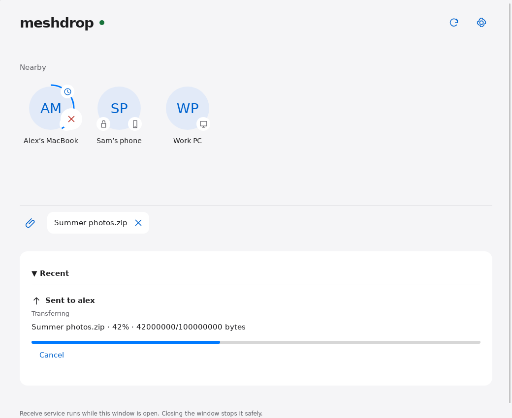

# meshdrop

**Private-network file invitations for Linux, Windows, macOS and Android.** No cloud,
public CA or Tailscale account required. The Rust core is shared by the CLI and
Tauri desktop and Android apps. GPL-3.0-or-later; see [LICENSE](LICENSE).

## Download and install

Download the RPM (Linux x86_64), universal DMG (Apple Silicon and Intel macOS),
or arm64 APK from [GitHub Releases](https://github.com/AquilaWei/meshdrop/releases).
Download `SHA256SUMS` from the same release. Before installing, verify the file:

```sh
# Linux; checks downloaded files, ignoring installers for other platforms:
sha256sum --ignore-missing --check SHA256SUMS
# macOS (download all three installers for this command):
shasum -a 256 --check SHA256SUMS
# For an APK downloaded on Linux, use the first command above, then copy it to Android.
```

All downloaded files must report **OK**. Checksums detect corruption; obtain the
installers and checksum file from the trusted repository release together.

```sh
# Fedora; replace VERSION with the release number shown on GitHub:
sudo dnf install ./meshdrop-VERSION-x86_64.rpm
meshdrop-app
# macOS:
open ./meshdrop-VERSION-universal.dmg
# Drag meshdrop.app to Applications, then open it from Applications.
# Android, with your own device selected in adb (or open the APK on the phone):
adb install ./meshdrop-VERSION-arm64.apk
```

The DMG is **unsigned and not notarized**. If Gatekeeper blocks it, first try
opening meshdrop in Applications, then go to **System Settings → Privacy &
Security → Open Anyway** and confirm Open. On macOS versions that support it,
Finder Control-click → Open also offers explicit approval. Do this only for a
release you trust; do not disable Gatekeeper globally.

The release APK and development debug APK have **different signing keys**.
Uninstall the debug app before installing a release APK. **Uninstalling deletes
app data, including pairing identities**; save needed app-private files first and
pair all devices again after installing. Android public Download files are kept.
Manual workflow artifacts contain `NOT-FOR-DISTRIBUTION` in their filenames and
use temporary keys; they are validation artifacts, not upgrades or releases.

## Release signing setup (maintainer)

Run these commands yourself on your trusted machine. Keep the keystore outside
this repository and back it up securely; losing it prevents compatible APK
updates. Keytool prompts for the password, so no password is placed in shell
history. This PKCS12 key uses the same store and key password.

```sh
mkdir -p "$HOME/.local/share/meshdrop-signing"
chmod 700 "$HOME/.local/share/meshdrop-signing"
keytool -genkeypair -storetype PKCS12 \
  -keystore "$HOME/.local/share/meshdrop-signing/release.p12" \
  -alias meshdrop-release -keyalg RSA -keysize 3072 -validity 10000 \
  -dname 'CN=meshdrop release'
chmod 600 "$HOME/.local/share/meshdrop-signing/release.p12"
base64 < "$HOME/.local/share/meshdrop-signing/release.p12" | \
  gh secret set ANDROID_KEYSTORE_BASE64 --repo AquilaWei/meshdrop
gh secret set ANDROID_KEY_ALIAS --repo AquilaWei/meshdrop --body meshdrop-release
# Each command prompts securely; enter the keytool password for both:
gh secret set ANDROID_KEYSTORE_PASSWORD --repo AquilaWei/meshdrop
gh secret set ANDROID_KEY_PASSWORD --repo AquilaWei/meshdrop
```

The tag workflow requires all four secrets. Never paste their values into an
issue, chat or build log. Version metadata comes from the root `Cargo.toml`.
The release workflow runs full desktop/Android CI, builds the three installers,
launches the RPM under Xvfb and the mounted DMG on macOS, verifies APK metadata
and signature, then creates `SHA256SUMS`. Release notes are extracted from the
matching CHANGELOG section. A manual `gh workflow run release.yml --ref master`
is a dry run and cannot create a Release. ARM64 APK emulator launch acceptance
runs locally using the private `tests/android` AVD infrastructure; hosted x86_64
Linux runners only verify the arm64 APK metadata and signature.

## Try it

Install stable Rust with Cargo, then:

```sh
cargo build -p meshdrop-cli --locked
cargo run --bin meshdrop -- --help
# On the receiving machine (leave this running):
cargo run --bin meshdrop -- receive
# In another terminal, show your identity and terminal QR:
cargo run --bin meshdrop -- id --host 192.168.1.10
# On the sender; compare the six-digit code on BOTH machines and answer y:
cargo run --bin meshdrop -- pair 192.168.1.10:9843
cargo run --bin meshdrop -- devices
cargo run --bin meshdrop -- send 192.168.1.10:9843 ./README.md ./LICENSE
```

Replace the example address with the receiver's reachable IP. `pair` also accepts
the full `meshdrop://…` QR payload. Both users must confirm pairing. A changed
certificate is rejected with a fingerprint mismatch error. Keep the identity
file private and do not copy it between devices.

`receive --auto-accept` accepts file invitations, while `--auto-reject` rejects
them. Both still require manual pairing confirmation. Without either flag, the
receiver prompts for each offer. Ctrl-C or SIGTERM terminates reception and cleans
partial files. Completed files are SHA-256 verified and never overwrite existing
names. Transfers stream in bounded chunks and report progress on stderr.

For two local instances, use `--state-dir /path/to/private/state` on every command
and set different ports in their config files. `pair --advertise host:port` sets
a return address explicitly; otherwise the CLI derives it from the route to the
peer. Firewall rules must permit the configured TCP port and UDP 5353 for mDNS.

## Configuration

Desktop and CLI receives default to the system **Downloads** folder (Linux XDG,
Windows or macOS). If no Downloads setting exists, `home/Downloads` is used.
The launch directory does not affect this default. An explicit `receive_directory`
takes priority; relative configured paths resolve beside the loaded `config.toml`,
including with `--config` and `--state-dir`.

`directories` selects the platform config directory: typically
`~/.config/meshdrop` on Linux, `%APPDATA%\meshdrop` on Windows, and
`~/Library/Application Support/org.meshdrop.meshdrop` on macOS. Use
`--state-dir` or `--config` to override. Missing TOML uses defaults; unknown keys
and invalid values report the configuration filename.

```toml
# Optional: relative paths resolve beside this config.toml
receive_directory = "incoming"
port = 9843
allowed_networks = ["10.0.0.0/8", "172.16.0.0/12", "192.168.0.0/16", "100.64.0.0/10", "169.254.0.0/16", "127.0.0.0/8", "::1/128", "fc00::/7", "fe80::/10"]
providers = ["mdns", "manual", "peer-list"]
invitation_timeout_seconds = 60
idle_timeout_seconds = 60
name = "my-laptop"
```

Add `"tailscale"` to providers for optional local `tailscale status --json`
discovery. Missing tools return a reason. Manual candidates can be passed to
`devices host:9843`. Discovery groups successful probes by TLS fingerprint and
preserves all observed addresses. Unresolved candidates fall back to address
grouping. Discovery does not automatically trust candidates. Peer-list queries
already paired devices; an unreachable peer does not hide other results.
Provider failures are diagnostics on stderr; usable devices remain on stdout.
Probes run concurrently with a limit of sixteen; Tailscale offline peers are
listed without probing.
Invitation timeout limits confirmation waiting; idle timeout limits gaps between
received chunks and accepted uploads that never start. Sustained transfers have
no total-duration limit. The old `timeout_seconds` key is rejected; replace it
with the two explicit keys above. Multi-file completion is per
file, so successfully completed files remain if a later file fails.

## Contribute and verify

Android development uses a user-owned compatible JDK, SDK and NDK; set
`JAVA_HOME`, `ANDROID_HOME` and `NDK_HOME` to those installations. For example,
`JAVA_HOME=$HOME/.local/share/meshdrop-android/jdk-17` can be reused by scripts.
From `crates/meshdrop-app`, run `cargo tauri android build --debug --target aarch64`
for a typical ARM64 phone, or use `--target x86_64` for the emulator. Install the
Rust target for that ABI with `rustup target add aarch64-linux-android` or
`rustup target add x86_64-linux-android`. The Android runner checks a debug APK and
JVM unit tests; its tool requirements, swangle renderer and container fallback are recorded in
[tests/android/README.md](tests/android/README.md).
No host system packages or release signing keys are installed by this project.


```sh
cargo fmt --all -- --check
cargo clippy --workspace --all-targets -- -D warnings
cargo test --workspace
# Rootless Podman by default; CONTAINER_ENGINE=docker selects Docker:
./tests/docker/run.sh
./tests/wine/run.sh
./tests/ui/run.sh
# Android KVM runtime check (Emulator 37.1.11, swangle):
./tests/android/run.sh
# Optional pinned-emulator container fallback (after building the debug APK):
./tests/android/container.sh
```

Container scripts download images and build dependencies inside containers. Wine
and MinGW are never installed on the host. The three-peer scenario checks real
multicast discovery, explicit pairing, bidirectional transfer hashes and rejection.
The Windows suite runs core and CLI tests in Wine; Linux-only `/proc` VmHWM
measurement is excluded by target configuration. Real Windows, macOS and multicast
LAN behavior still need the [acceptance checklist](docs/acceptance.md). CI verifies
fmt, clippy and tests on Ubuntu, Windows and macOS, plus an Android debug APK
build job. All four hosted jobs have passed on the public
[AquilaWei/meshdrop repository](https://github.com/AquilaWei/meshdrop).

The Xvfb/WebDriver suite covers discovery timing, stable rendering and the complete
connect → choose → send flow against real CLI peers.
Its chooser-result injection and native UI limits are documented in
[tests/ui/README.md](tests/ui/README.md). Wine also checks the Windows app target;
WebView2 UI execution requires native Windows.

See [protocol](docs/protocol.md), [progress](progress.md), and
[feature list](feature_list.json). Android emulator interoperability passes; physical acceptance remains pending. iOS, Bluetooth and
Taildrop compatibility are outside scope.

## Desktop app (Tauri 2)

The desktop shell uses static HTML/CSS/JS without Node, a frontend framework or a
bundler. On Linux it needs Tauri's GTK 3 / WebKitGTK 4.1 development libraries;
Windows needs the native Rust toolchain and WebView2, macOS needs Xcode tools.
No host packages are installed by the repository scripts.

```sh
cargo build -p meshdrop-app --locked
cargo run -p meshdrop-app --locked
```

The window starts the core receiver and mDNS advertisement in the same process;
closing it cancels reception and withdraws discovery. Use `MESHDROP_STATE_DIR` to
select an isolated profile; otherwise the CLI and app share the platform config
folder and cannot bind the same port simultaneously.



The shared desktop/Android main page shows nearby device avatars, selected files
and collapsible **Recent** transfers. Search runs once at launch, when you press
**↻**, and every **30 seconds** while the app is visible and in the foreground.
Hidden/background apps pause searches; Android continues receiving. Unchanged
snapshots preserve the device grid and skip QR redraws. Only reachable devices
with a successful meshdrop certificate probe appear. Discovery never grants trust.

**Connect first, then press ＋ to choose files, then tap the connected device to send.**
Tapping an unpaired avatar only opens the pairing confirmation. Compare the
six-digit code on both devices and confirm on both sides; the avatar then shows
**Connected**. Pairing does not send files. The bottom **＋** is the only in-app
file picker: add files over several picks and remove any file chip. Tapping a
connected avatar sends all selected files in **one invitation**. With no files,
it announces “Press + to choose files first.” Fingerprint mismatches disable the
avatar. Incoming invitations still require an explicit decision.

Each transfer shows progress and its result. Active avatars have a separate
44px **Cancel** target below the avatar and progress ring. Invitation sizes use
readable units such as **2.4 MB**. Recent shows saved locations, desktop
reveal-in-folder and Android sharing controls. Device names and filenames render
as text. Desktop drag/drop no longer selects files; use **＋**.

**Settings** is one flat list: device name, QR and fingerprint; Add Device (with
Android QR scanning); discovery provider checkboxes; notifications; receive folder
(with a desktop open button, or **Download** on Android); Android **Stop receiving**.
Name, receive folder and providers are marked **restart required**. Notification
changes apply immediately after saving. Android received-file sharing is in Recent.
Settings are saved atomically to the shared `config.toml`.

**Advanced settings are edited by hand.** Close the app, open `config.toml` in the
platform config directory listed above, edit `port`, `allowed_networks`,
`invitation_timeout_seconds` or `idle_timeout_seconds`, save, and restart. The
example in Configuration shows their unchanged defaults. Keep the existing keys;
unknown keys or invalid values produce an error with the filename. The built-in
TOML editor and diagnostics panel have been removed. To inspect discovery
failures, run `cargo run --bin meshdrop -- devices` with the same `--state-dir` or
`--config`; provider diagnostics are printed on stderr. The editor and diagnostics
are tools/views, not new TOML keys. Closing the desktop app stops its receiver.

On Linux, launch `./target/debug/meshdrop-app`; on Windows, launch
`target\debug\meshdrop-app.exe` (WebView2 must be installed). On macOS, run
`./target/debug/meshdrop-app` from Terminal. For an unsigned `.app` bundle,
open Finder and **right-click → Open** on first launch, then confirm Open.
If Gatekeeper blocks it, go to **System Settings → Privacy & Security → Open
Anyway**, authenticate, and confirm Open. No signing or release is performed here.

Native appearance and notification permissions still need the checks in
[the acceptance checklist](docs/acceptance.md).

## Android app

The Android target shares the same core and static interface. Build a debug APK
using the development command above, then install the generated debug APK with
`adb install -r PATH_TO_DEBUG_APK`, or open it on your device and explicitly allow
installation from that source. Only Gradle's automatic debug key is used.

On **Android 10+ (API 29+)**, verified files are streamed into the public
**Download** collection through MediaStore. Pending entries stay hidden until the
copy finishes and are deleted on copy failure. New entries and collision renaming
preserve existing files. No broad storage permission is requested. The completion
view shows the Download name and content URI. A verified private copy is retained
for the received-files list; **Recent → Share** shares the public entry with a temporary read grant.

On **Android 9 and below**, receives remain in app-private storage; uninstalling
the app deletes them. Sharing exposes only completed receive files through
FileProvider, never partial files or private identities.

Select one or multiple files in another app’s **Share** menu and choose
**meshdrop**. Cold starts and an already-open app import those content URIs into
private send-cache files, then open the device-pick page with files selected.
The document chooser and share target both copy in bounded buffers (at most 128
files per import), never loading whole files into memory.

On Android 13+, allow notification permission when requested. Denying it is shown
in the app; incoming invitations still require explicit acceptance. Background
reception uses an ongoing notification with **Stop receiving**. Home keeps the
receiver process alive through a dataSync foreground service and holds the Wi-Fi
multicast lock. The notification toggle controls invitation alerts; the foreground
service notification is required while receiving. Stop releases the lock, cancels transfers and closes the listener.
Android 15+ may limit dataSync background runtime; after the system stops it,
reopen the app to start receiving again. Doze and OEM policies need real-device
acceptance. The emulator runner covers sharing, public Downloads and real bidirectional transfers
with swangle; see `tests/android/README.md`.
**Scan pairing QR** requests camera permission and accepts meshdrop QR content.
A rejected camera permission leaves manual host:port / pasted QR input available.
Scanning only adds a candidate; pairing still requires matching codes and explicit
confirmation on both devices. Camera optics require real-phone acceptance.
Tailscale enumeration and desktop folder opening are unavailable on Android;
use a manual private VPN address instead. Android stages verified files in `files/meshdrop/received` inside the app
data directory before publication; its receive-folder setting is read-only.
